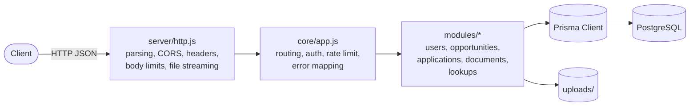
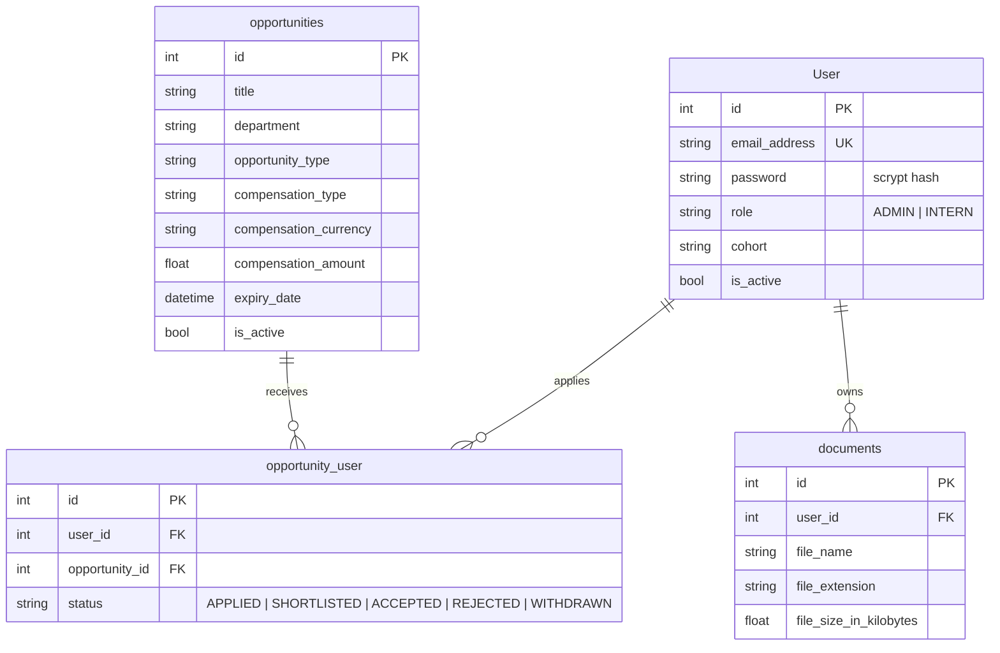

# CareerIgnite

A REST API for running an internship and early-career programme: administrators publish **opportunities**, interns register, **apply**, upload their **documents** (CVs, certificates), and administrators review applicants through a simple status workflow.

Built with **Node.js**, **PostgreSQL** and **Prisma**. The only runtime dependencies are `@prisma/client` and `@faker-js/faker` (seed data); HTTP, JWT auth, password hashing and validation use Node's standard library.

---

## Table of contents

- [Features](#features)
- [Architecture](#architecture)
- [Data model](#data-model)
- [Getting started](#getting-started)
- [Configuration](#configuration)
- [API reference](#api-reference)
- [Conventions](#conventions)
- [Security](#security)
- [Testing](#testing)
- [Project structure](#project-structure)
- [Design decisions](#design-decisions)
- [Roadmap](#roadmap)
- [License](#license)

---

## Features

- **Authentication and roles**: registration, login with short-lived JWTs, `ADMIN` / `INTERN` roles, self-service profile and password change.
- **Opportunity management**: create, search, filter and sort; expired and inactive postings are hidden from the public automatically.
- **Application workflow**: `APPLIED → SHORTLISTED → ACCEPTED / REJECTED`, with withdrawal and re-application. One application per person per opportunity (enforced in the database).
- **Document uploads**: PDF, DOC/DOCX, PNG and JPG up to a configurable size, validated by file signature (not just extension), stored under server-generated names.
- **Reference data**: departments, opportunity types, compensation types, cohorts and titles, managed by admins. Opportunities and users are validated against them.
- **Soft deletes** everywhere (`is_active = false`), preserving history and audit columns (`created_by`, `created_at`, `updated_at`).
- **Consistent API**: pagination, sorting, search, uniform JSON error format.
- **Seeder and CLI**: idempotent seed script, optional demo data, and a command to create the first admin.

## Architecture



The HTTP layer is deliberately thin. All behaviour lives in `core/app.js`, which exposes a single `handle({ method, path, query, headers, rawBody, ip })` function that returns `{ status, body }`. This keeps the application independent of any web framework and lets the tests exercise every endpoint without sockets or a database. Mounting it inside Express, Fastify or a serverless function is a few lines of glue:

```js
// Express example
app.use('/api', express.raw({ type: '*/*', limit: '10mb' }), async (req, res) => {
  const out = await core.handle({
    method: req.method, path: req.originalUrl.split('?')[0], query: req.query,
    headers: req.headers, rawBody: req.body, ip: req.ip,
  });
  res.status(out.status).set(out.headers).json(out.body);
});
```

## Data model



`Department`, `opportunity_types`, `compensation_types`, `cohorts` and `titles` are standalone lookup tables. Other tables reference them **by name** (not by foreign key), a choice inherited from the original schema; the API validates those names on write (see [Design decisions](#design-decisions)).

## Getting started

### Prerequisites

- Node.js **20.12+** (22 recommended)
- PostgreSQL 14+ (or Docker, to use the bundled compose file)

### Setup

```bash
# 1. Install dependencies (also generates the Prisma client)
npm install

# 2. Start a local database (skip if you already have PostgreSQL)
docker compose up -d

# 3. Configure the environment
cp .env.example .env
#    then set JWT_SECRET, e.g.:
#    node -e "console.log(require('crypto').randomBytes(48).toString('hex'))"

# 4. Create the tables
npm run db:migrate          # development
# npm run db:deploy         # production / CI

# 5. Seed reference data and an admin account (add -- --demo for sample data)
npm run db:seed
npm run db:seed -- --demo

# 6. Run
npm run dev                 # auto-restart on changes
npm start                   # plain start
```

The API listens on `http://localhost:3000`. Check it with `curl localhost:3000/api/health`.

The seed creates the admin from `SEED_ADMIN_EMAIL` / `SEED_ADMIN_PASSWORD` (defaults in `.env.example`: `admin@careerignite.local` / `ChangeMe123!`). **Change this password immediately outside local development.** To create another account:

```bash
npm run user:create -- --email jane@example.com --password 'S3cretPass1' \
  --first-name Jane --last-name Doe --role ADMIN
```

### Try it

```bash
# Log in as the seeded admin
TOKEN=$(curl -s localhost:3000/api/auth/login -H 'Content-Type: application/json' \
  -d '{"email_address":"admin@careerignite.local","password":"ChangeMe123!"}' | jq -r .token)

# Publish an opportunity
curl -s localhost:3000/api/opportunities -H "Authorization: Bearer $TOKEN" \
  -H 'Content-Type: application/json' -d '{
    "title": "Backend Intern", "department": "Engineering",
    "opportunity_type": "Internship", "compensation_type": "Stipend",
    "compensation_currency": "KES", "compensation_amount": 40000,
    "opportunity_description": "Build and maintain APIs.",
    "core_competencies": "Node.js, SQL", "expiry_date": "2026-12-31"
  }'

# Browse (public, no token needed)
curl -s 'localhost:3000/api/opportunities?q=backend&sort=-created_at'

# Upload a CV as a signed-in user
curl -s "localhost:3000/api/documents?name=My%20CV&filename=cv.pdf" \
  -H "Authorization: Bearer $INTERN_TOKEN" \
  -H 'Content-Type: application/octet-stream' --data-binary @cv.pdf
```

## Configuration

All settings are environment variables (a `.env` file is loaded automatically if present).

| Variable | Default | Description |
| --- | --- | --- |
| `DATABASE_URL` | — | PostgreSQL connection string (**required**) |
| `JWT_SECRET` | random per run (dev only) | HMAC secret. **Required in production, min. 32 chars** |
| `JWT_EXPIRES_IN` | `1h` | Token lifetime: `30m`, `12h`, `7d`… |
| `PORT` | `3000` | HTTP port |
| `NODE_ENV` | `development` | `production` enables the stricter checks above |
| `CORS_ORIGIN` | *(none)* | Comma-separated allowed origins, or `*` |
| `TRUST_PROXY` | `false` | Honour `X-Forwarded-For` (set only behind a trusted proxy) |
| `AUTH_RATE_LIMIT_MAX` | `20` | Login/register attempts per IP per window |
| `AUTH_RATE_LIMIT_WINDOW` | `15m` | Rate-limit window |
| `UPLOAD_DIR` | `uploads` | Where documents are stored |
| `MAX_UPLOAD_MB` | `5` | Maximum upload size |
| `SEED_ADMIN_EMAIL` / `SEED_ADMIN_PASSWORD` | see `.env.example` | Admin created by the seeder (required when seeding in production) |

## API reference

Base path `/api`. **Auth** column: `public` = no token, `optional` = token changes what you see, `user` = any signed-in user, `admin` = administrators only. Authenticate with `Authorization: Bearer <token>`.

### Auth and profile

| Method | Path | Auth | Description |
| --- | --- | --- | --- |
| GET | `/health` | public | Liveness check |
| POST | `/auth/register` | public | Create an intern account |
| POST | `/auth/login` | public | Exchange credentials for a token |
| GET | `/me` | user | Current user |
| PATCH | `/me` | user | Update profile; changing `password` requires `current_password` |
| GET | `/me/applications` | user | My applications (`?status=`) |

### Users (admin)

| Method | Path | Description |
| --- | --- | --- |
| GET | `/users` | List (`?q=&role=&cohort=&include_inactive=&sort=`) |
| POST | `/users` | Create, including `role` |
| GET / PATCH / DELETE | `/users/:id` | Read, update, deactivate. Admins cannot demote or deactivate themselves |

### Opportunities and applications

| Method | Path | Auth | Description |
| --- | --- | --- | --- |
| GET | `/opportunities` | optional | List open postings. Filters: `q`, `department`, `opportunity_type`, `compensation_type`; sort: `created_at`, `expiry_date`, `title`, `compensation_amount`. Admins may add `include_inactive`, `include_expired` |
| GET | `/opportunities/:id` | optional | Read one |
| POST | `/opportunities` | admin | Create |
| PATCH / DELETE | `/opportunities/:id` | admin | Update / deactivate |
| POST | `/opportunities/:id/apply` | user | Apply (re-activates a withdrawn application) |
| GET | `/opportunities/:id/applicants` | admin | Applicants with user details (`?status=`) |
| PATCH | `/applications/:id` | admin | Set `status` to `APPLIED`, `SHORTLISTED`, `ACCEPTED` or `REJECTED` |
| DELETE | `/applications/:id` | user | Withdraw (owner or admin) |

### Documents

| Method | Path | Description |
| --- | --- | --- |
| POST | `/documents?name=&filename=&description=` | Upload: the request body is the raw file bytes. Allowed: `pdf, doc, docx, png, jpg, jpeg` |
| GET | `/documents` | Own documents (admins: all, or `?user_id=`) |
| GET | `/documents/:id` | Metadata (owner or admin; others get 404) |
| GET | `/documents/:id/download` | Download the file |
| DELETE | `/documents/:id` | Soft delete |

### Reference data

Identical endpoints for each of `departments`, `opportunity-types`, `compensation-types`, `cohorts` and `titles`:

| Method | Path | Auth |
| --- | --- | --- |
| GET | `/<resource>` (`?q=&sort=&page=&limit=`) and `/<resource>/:id` | user |
| POST | `/<resource>` | admin |
| PATCH / DELETE | `/<resource>/:id` | admin |

Names are unique per resource (case-insensitive). Cohorts require `end_date` after `start_date`.

## Conventions

**Pagination**: `?page=1&limit=20` (max 100). Responses: `{ "data": [...], "meta": { "page", "limit", "total", "total_pages" } }`. Single resources are wrapped as `{ "data": {...} }`.

**Sorting**: `?sort=field` or `?sort=-field` for descending, restricted to a whitelist per endpoint.

**Errors** always look like this:

```json
{
  "error": {
    "code": "validation_error",
    "message": "Validation failed",
    "details": { "email_address": "must be a valid email address" }
  }
}
```

| Status | `code` | Meaning |
| --- | --- | --- |
| 400 | `bad_request` | Malformed JSON, empty update, empty file |
| 401 | `unauthorized` | Missing, invalid or expired token; bad credentials |
| 403 | `forbidden` | Authenticated but not allowed |
| 404 | `not_found` | Missing, or not visible to you |
| 405 | `method_not_allowed` | Wrong verb (see the `Allow` header) |
| 409 | `conflict` | Duplicate, already applied, closed opportunity, lock-out protection |
| 413 | `payload_too_large` | Body exceeds the limit |
| 422 | `validation_error` | Field-level problems, listed in `details` |
| 429 | `rate_limited` | See the `Retry-After` header |
| 500 | `internal_error` | Unexpected failure; details are logged, never returned |

## Security

- **Passwords**: scrypt with a per-password random salt; never returned by any endpoint. Login responses are identical for unknown email, wrong password and disabled account, and an unknown email still performs a hash to avoid timing leaks.
- **Tokens**: HS256 JWTs with the algorithm pinned (`alg: none` and other algorithms are rejected), signature compared in constant time, expiry enforced. Every request re-reads the user from the database, so deactivating an account or changing a role takes effect immediately and a token's own `role` claim is never trusted.
- **Authorization**: role checks per route plus ownership checks on applications and documents. Accessing someone else's record returns 404, so IDs can't be probed.
- **Mass assignment**: only whitelisted fields are accepted; clients cannot set their own `role`, `is_active` or `created_by`.
- **Uploads**: extension allow-list, magic-byte verification, size limit enforced while streaming, server-generated storage names (the client file name is never used as a path), and a path-containment check on download. Files are served as attachments with `nosniff`.
- **Abuse controls**: per-IP rate limit on login and registration (in-memory, single instance), request body limits, strict `:id` parsing.
- **Headers**: `X-Content-Type-Options`, `X-Frame-Options`, `Referrer-Policy`, a locked-down `Content-Security-Policy`, `Cache-Control: no-store`; CORS is opt-in per origin.
- **Production**: the app refuses to start without a `JWT_SECRET` of at least 32 characters. Terminate TLS at a reverse proxy, and set `TRUST_PROXY=true` only when one is present.

## Testing

```bash
npm test
```

The suite uses Node's built-in test runner (no extra dependencies) and covers authentication and token handling, authorization boundaries, validation, every resource's CRUD behaviour, the application lifecycle, upload and download security, HTTP concerns over real sockets (CORS, limits, headers, binary downloads), and the seeder's idempotency.

> **Note on the database layer.** Tests run against an in-memory stand-in for Prisma Client (`test/helpers/fakeDb.js`) so they need no PostgreSQL. It models the Prisma query features the app uses, along with defaults and unique constraints. It does not validate the generated SQL, so before releasing, run through the [Try it](#try-it) walkthrough once against a real database after applying the migrations.

## Project structure

```
careerignite/
├── prisma/
│   ├── schema.prisma          # data model
│   ├── migrations/            # SQL migrations (incl. roles, applications, constraints)
│   ├── factories/             # faker-based factories for seeding
│   └── seed.js                # idempotent seeder
├── scripts/createUser.js      # CLI to create users/admins
├── src/
│   ├── server.js              # entry point, graceful shutdown
│   ├── config.js              # environment parsing + production checks
│   ├── db.js                  # shared PrismaClient
│   ├── routes.js              # route table
│   ├── core/                  # app.js (dispatcher), auth helpers, response helpers
│   ├── server/http.js         # node:http adapter (CORS, headers, body limits, streaming)
│   ├── lib/                   # jwt, password, validate, query, rateLimit, errors
│   └── modules/               # users, opportunities, applications, documents, lookups, crud
├── test/                      # node:test suites + in-memory Prisma stand-in
├── docker-compose.yml         # local PostgreSQL
└── .env.example
```

## Design decisions

- **No web framework.** The surface area (JSON in, JSON out, one binary upload and one download) is small, so Node's `http` module plus a declarative route table keeps dependencies minimal. The core is transport-agnostic if you later prefer Express or Fastify (see [Architecture](#architecture)).
- **Soft deletes.** The schema carries `is_active` on every table, so `DELETE` deactivates. Lists hide inactive rows from non-admins, and admins can opt in with `include_inactive`.
- **Lookups by name.** Departments, types and cohorts are stored as strings on other tables (the original design). The API checks each value against its active lookup row and stores the canonical spelling. Migrating these to real foreign keys would be a worthwhile future change but is a breaking schema decision, so it was left to you.
- **Schema additions** (migration `20261002120000_add_roles_applications_constraints`):
  `User.role`; unique `User.email_address` (needed for login); `User.middle_name` made optional; `opportunity_user.status` and `created_at` with a unique `(user_id, opportunity_id)`; indexes on common filters.
  If existing data contains duplicate e-mails or duplicate applications, the migration will fail with a clear message. De-duplicate first.
- **Open-ness is computed, not stored.** An opportunity is "open" when it is active and `expiry_date` is in the future, so there is no background job to flip a flag.

## Roadmap

- Replace the in-memory rate limiter with a shared store (Redis) for multi-instance deployments
- Refresh tokens and password-reset by e-mail
- Notifications when an application's status changes
- Object storage (S3-compatible) for documents, with virus scanning
- Foreign keys for the name-based lookups
- OpenAPI specification and generated client

## License

[ISC](LICENSE)
